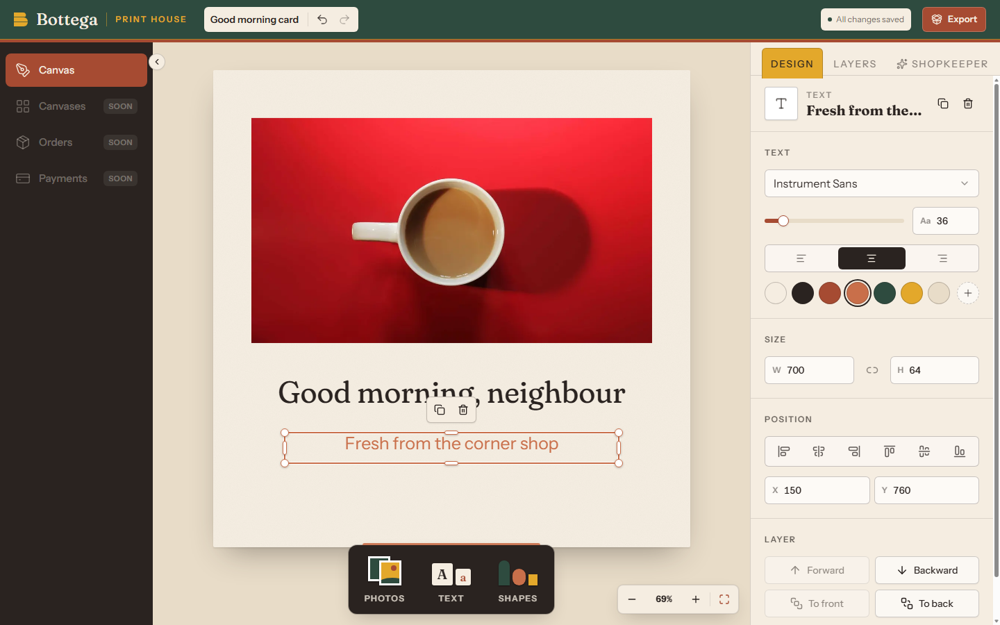

# Bottega

A free, open-source design editor for print products — mugs, t-shirts and greeting cards — built
around licensed stock photography.

[](LICENSE)
[](https://bun.sh)
[](https://nextjs.org)
[](https://react.dev)
[](https://www.typescriptlang.org)
[](https://trpc.io)
[](https://tailwindcss.com)
[](https://ui.shadcn.com)
[](#contributing)



## What it is for

Bottega lets anyone lay out a photo and words on a page and see it on a real product before
ordering. It is for small shops, makers and people making a one-off gift who want a good-looking
print without learning a professional design tool. It is free to use, self-host and change under
the [MIT licence](LICENSE).

## Features

- **Canvas editor** — photos, text and shapes; drag, resize with handles, align to the page,
  layer order, opacity, undo/redo, zoom, autosave.
- **Any font** — search and preview 1,630 Google Fonts by name or kind; each loads only when used.
- **Any colour** — full colour picker with hex input, brand presets and the colours already in
  the design.
- **Photo shelf** — searchable library with topics; click to place or drag onto the page.
- **Page sizes** — Square, Portrait 4:5, Card 5:7, Landscape 3:2.
- **Product preview** — see the design on a mug, t-shirt or greeting card at true print
  proportions, with anything outside the print area shown faded.
- **Shopkeeper assistant** — asks what you are making and suggests photos and layout.

## Status

Bottega is in active development. These parts are stand-ins today:

| Area                       | Today                                      | Planned        |
| -------------------------- | ------------------------------------------ | -------------- |
| Photo library              | Placeholder photos from picsum.photos      | Stocksy API    |
| Shopkeeper assistant       | Keyword rules                              | Language model |
| Storage                    | In memory; resets when the server restarts | Database       |
| Checkout                   | Demo only — no payment, nothing ships      | Real checkout  |
| Canvases, Orders, Payments | Listed in the menu, not built yet          | —              |

## Getting started

### Prerequisites

- [Bun](https://bun.sh) 1.2.18 or newer
- [Node.js](https://nodejs.org) 20.9 or newer (Next.js runs on Node)

### Install and run

```sh
git clone https://github.com/kcaparas1630/Bottega.git
cd Bottega
bun install
bun run dev
```

Open [http://localhost:3000](http://localhost:3000). No environment variables or accounts are
needed.

For a production build:

```sh
bun run build
bun run start
```

## Usage

1. **Add** — use the counter at the bottom of the page: **Photos** (search, then click or drag),
   **Text** (heading, subheading, body) or **Shapes**.
2. **Edit** — select anything on the page. The **Design** panel on the right sets font, size,
   alignment, colour, size, position, layer and opacity. Double-click text to type into it.
3. **Set up the page** — with nothing selected, the Design panel sets page size and paper colour.
4. **Export** — click **Export**, pick a product, check the preview, then try the demo checkout.

Work saves automatically; rename the canvas in the header.

### Keyboard shortcuts

| Action                      | Shortcut                                          |
| --------------------------- | ------------------------------------------------- |
| Undo / redo                 | `Ctrl/⌘ Z` / `Ctrl/⌘ Shift Z` or `Ctrl Y`         |
| Duplicate                   | `Ctrl/⌘ D`                                        |
| Delete                      | `Delete` or `Backspace`                           |
| Nudge (10 units with Shift) | Arrow keys                                        |
| Deselect                    | `Esc`                                             |
| Zoom                        | `Ctrl/⌘` + scroll                                 |
| Edit text / finish editing  | Double-click or `Enter` / `Esc` or `Ctrl/⌘ Enter` |

## Scripts

| Command                     | What it does                                     |
| --------------------------- | ------------------------------------------------ |
| `bun run dev`               | Start the app in development mode                |
| `bun run build`             | Build for production                             |
| `bun run start`             | Serve the production build                       |
| `bun run verify`            | Format check, lint, convention checks, typecheck |
| `bun run lint`              | ESLint, zero warnings allowed                    |
| `bun run format`            | Format everything with Prettier                  |
| `bun run typecheck`         | TypeScript for scripts, server and web           |
| `bun run check:conventions` | Whole-tree code convention checks                |

## Project structure

```
web/       Next.js app (App Router) in Feature-Sliced Design: app → widgets → features → entities → shared
server/    tRPC routers and server-only logic: designs, photo library, font catalogue, demo orders
scripts/   ESLint plugin and convention checks that run before every commit
docs/      Architecture decisions (adr/) and code conventions (code-conventions/)
```

The stack, structure and rules are documented in [`docs/`](docs/README.md).

## Contributing

Contributions are welcome — bug reports, ideas and pull requests.

1. Open an [issue](https://github.com/kcaparas1630/Bottega/issues) for anything larger than a
   small fix, so the approach can be agreed first.
2. Fork the repository and create a branch.
3. Follow the [code conventions](docs/code-conventions/index.md); a pre-commit hook enforces them.
4. Run `bun run verify` and make sure it passes.
5. Open a pull request that explains what changed and why. Include a screenshot for UI changes.

Significant design decisions are recorded as [ADRs](docs/adr/index.md); add one if your change
makes a new decision.

## License

[MIT](LICENSE) © 2026 Kent Caparas.

Placeholder photos are served by [picsum.photos](https://picsum.photos) from Unsplash, and fonts
load from [Google Fonts](https://fonts.google.com); both are covered by their own licences, not by
this repository's.
